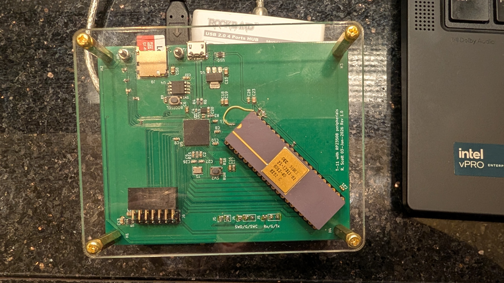
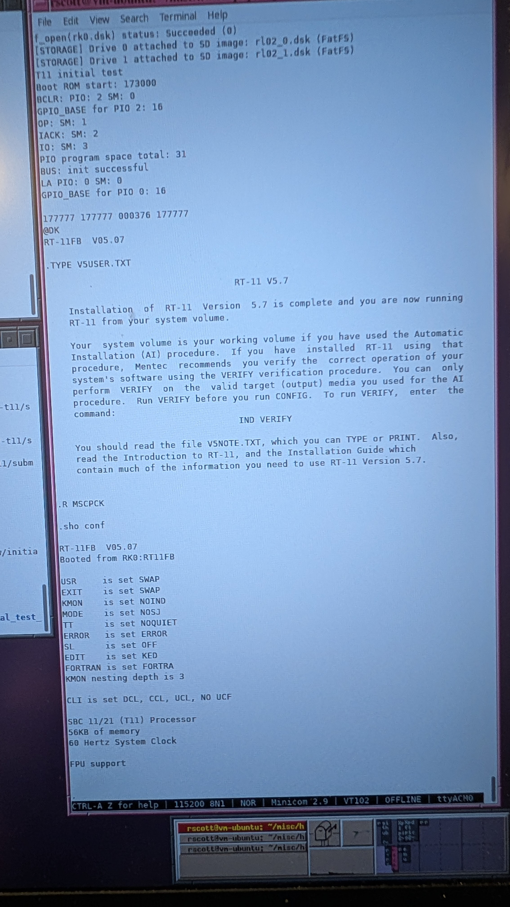
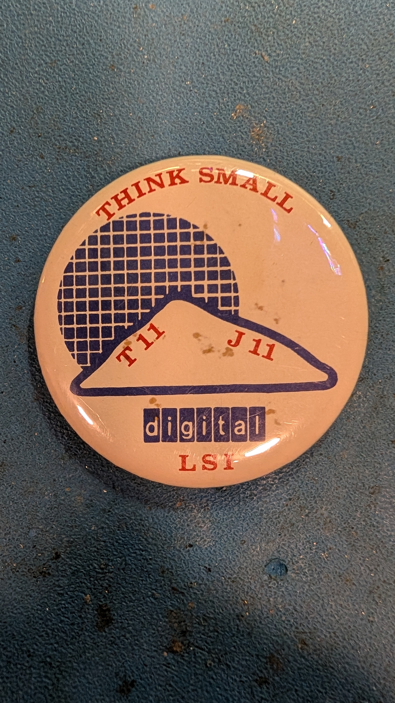

# T-11/RP2350

## 1.0 Introduction

This document describes the T-11/RP2350 project. The RP2350 serves memory
and peripherals to the Digital Equipment Corp (DEC) Tiny-11 (DCT-310) single
chip PDP-11. Currently, the board is able to boot and run RT-11 5.07.

## 1.1 Emulated system

Currently, the following devices are emulated:
1) KW11 - line time clock, configurable as 50 or 60 Hz. An RP2350 timer
provides the interval.
2) DL11 - single line UART. RP2350 SDK used to send/receive characters to/from
the T-11.
3) RK11 - 2.5 MB disk drive. This is mapped to a file on a micro SD card, using
the SDIO/FatFS libary.
4) M9312 - console and boot ROM card. Slightly modified PDP-11 boot ROM and
standard RK boot code storage is emulated.

## 1.1 Background

The T-11 as Digital's first single chip PDP-11, and was intended for commercial
board designs. As such, it was used for DEC products such as the VT240 terminal
and peripheral controllers. It saw limited commercial success, of which
the Paperboy video arcade console is one example. 

## 1.2 Motivation

I started with DEC right out of college, working for the Semiconductor
Engineering Group in Hudson, MA. My first assignment was supporting the T-11,
including design reviews, documentation, etc., so this project was a great way
to re-visit that part of my career. 

## 2.0 Design

The RP2350 is fast enough to provide full speed memory to the T-ll with
the use of PIO and DMA. Currently, the design uses about 50 clocks to provide
8/16 bit memory reads and writes using four DMA channels and one PIO instance
with it's four state machines. In addition to supporting memory, the other state
machines provide interrupt cycle support, T-11 mode register loading,
and forwarding of I/O requests to the RP2350 processor. The latter facility
copies I/O page memory requests to a dedicated FIFO so that the RP2350 can be
interrupted when I/O occurs.

## 2.1 I/O

When the T-11 performs a memory access to I/O space (the last 8KB), PIO
and DMA performs a read or write to the RP2350 internal memory to complete
the request. Simultaneously, another PIO engine pushes the address and data
to a PIO FIFO so that the RP2350 can update the affected I/O locations.
For instance, a T-11 read of the DL11 UART receive buffer must return the
RX buffer, and also clear the RX ready flag. So, the PIO/DMA machine will
return the emulated RX buffer contents, and I/O PIO machine will trigger
the RP2350 service routine to clear the RX ready flag. (Of course, there
is an implicit execution time limit: the flag must be cleared faster than
the T-11 can read the next memory location). In general, simple side effects
can be handled in a RP2350 interrupt service routine, while longer operations
must be handled by an event loop running at normal priority. Emulation of disk
drives is handled this way. 

## 3.0) Getting started

## 3.1) Hardware
Gerbers are in brd/pico2-t11_rev_1.0. 

Rev 1.0 requires the following ECOs:
1) Disconnect GPIO 47 from T11 pin 36 (VEC) and connect to T11 pin 39 (HALT).
2) Add 1k pullups resistors to: HALT (pin 39), PF (pin 38), and DMR (pin 32).
3) Add 1k pulldown resistors to: VEC (pin 37), and BCLR (pin 18).

## 3.2) Software
As configured, the default is to load the boot block from the RK05 image
on the SD card. There are defines for starting up test code in pdp11_src,
or starting the emulated m9312 boot rom code. 

### 3.2.1) Building
Some prerequistes:
1) macro11, from https://github.com/simh/simtools.git
2) obj2bin.pl, from https://github.com/AK6DN/obj2bin/blob/master/obj2bin.pl

Build steps:
1) cd to sw/initial_test_v1.0
2) Make a soft link to your installation of no-OS-FatFS-SD-SDIO-SPI-RPi-Pico.
3) cmake -B build -S .
4) make -C build -j

### 3.2.2 Booting RT-11
1) Get an RK05 RT-11 disk image, copy to a micro SD card with a name of
rk0.dsk, insert card into the microSD card slot on the board.
2) Start open-ocd and load initial_test.elf onto the board, and start it. RT-11 should then boot.

## 4.0) Techniques of interest:
### 4.1) PIO
1) Use the PIO mov dest,~src to invert bits for easy logical testing. E.g.
when determining if a bus operation was a read (0b11),  or one of: write
low byte, write high byte, or write word, inverting the control signals
made this a test for zero (read), or write (everything else).
2) Preload a register with a fixed value to avoid having to create it
via PIO instructions.
3) Use the wrap registers to jump in and out of other PIO engine code. This
allows zero overhead code sharing. However, the same code must be loaded
into the PIO state machines so that targets can be shared between them.
4) Use IRQ flags to signal another PIO SM with different pin maps to
support particular T11 transactions. E.g. the IACK transaction simultaneously
reads the interrupt vector on DAL<7:2>, while acknowledging the interrupt
on DAL<15:08>, thus requiring outputs only on the lower byte. To avoid
extra PIO instructions for manipulating the direction register, we configure
two SM instances: one with 16 bit DAL outputs, and one with 8 bits. Then,
we can use mov pindirs, ~NULL to set output direction in both machines.
5) Use out exec to enable the RP2350 to enable sharing of pins between PIO
and C running on the RP2350.
6) Use PC wrap from 31 to 0 to save a jump.

### 4.2) C code
1) Use a table driven function lookup to collapse IO decodes into a fixed
set of instructions. The first attempt at dispatching device emulators
resulted in a maximum T-11 speed of 3.5 MHz, due to the amount of
time needed to determine if the address was a device to be emulated or
not. Converting the serial execution of successive compares to a table of
functions dispatched via the I/O address allowed the T-11 to operate at
full speed. (Though a further, not yet fixed, bug in the disk emulation
limits speed to 7.3 MHz).
2) Use of the second core for capturing T-11 bus transactions is very
helpful when debugging.

## 5.0 Adventures while developing
### 5.1 Turns out, emulating old systems is never easy
So the initial design did not support the Q-bus and Unibus Non-Exsitent Memory
trap. T-11 doesn't have a built-in interrupt for this, and I thought that
a system generation step could be used to remove unneeded I/O devices from
RT-11. Unfortunately, after getting the board to load and run code from
the emulated RK05, I couldn't get RT-11 to boot. After some debugging,
I discovered that NXM is used to determine processor type, and without it,
a processor that uses instructions that the T-11 doesn't have, is selected.
So, used the HALT non-maskable interrupt to emulate NXM. It's not perfect,
as the same interrupt vector is shared between the NMI and HALT instruction
execution. Custom T-11 boot code attempts to distinguish between the two
cases, but it's not perfect.
### 5.2 Still debugging this one
The RL emulation still has a bug: a race condition between the interrupt
servicing the registers, and the main line code performing the actual
disk operations. I'm not certain where the race conditions is, but
better separation between the ISR's version of the command register and
the main line's might be the solution. I'm also suspicious of the RK
emulator, as it breaks when the T-11 is run at full speed. As far as I
can tell, there's no hardware reason that prevents this.
### 5.3 It's still cool
Amazed when the OS actually booted! Here's the first boot log entry:
```
4-oct-2026:

Thought about NXM generation: should only need to assert halt for reads, as
writes are always preceded by a read. Also, should count NXM services to
make sure they match with generated requests.

So, before eliminating write NXM
RKDA:   000006 lba:      6 00000006
NXM: 5
RKDA:   000020 lba:     12 0000000c
NXM: 5
RKDA:   000010 lba:      8 00000008
NXM: 5
RKDA:   000012 lba:     10 0000000a
NXM: 5
RKDA:   010211 lba:   3177 00000c69
NXM: 5
RKDA:   000263 lba:    135 00000087
NXM: 5
RKDA:   000264 lba:    136 00000088
NXM: 5
RKDA:   000553 lba:    275 00000113
NXM: 5
RKDA:   010207 lba:   3175 00000c67
NXM: 5

Looks like we're not NXMing during either the read or the write portion of
a write req. Let's try eliminating generating the write NXM req...works great:
RKDA:   000006 lba:      6 00000006
NXM: 5
RKDA:   000020 lba:     12 0000000c
NXM: 5
RKDA:   000010 lba:      8 00000008
NXM: 5
RKDA:   000012 lba:     10 0000000a
NXM: 5
RKDA:   010211 lba:   3177 00000c69
NXM: 5
RKDA:   000263 lba:    135 00000087
NXM: 5
RKDA:   000264 lba:    136 00000088
NXM: 5
RKDA:   000553 lba:    275 00000113
NXM: 5
RKDA:   010207 lba:   3175 00000c67

And scope confirms only halt assertions for reads.
Bottom line:
1) Halt assertions are captured during the reads of a T-11 write transaction.
2) T-11 write transactions are atomic: can't interrupt between the read and
write operations that make up a T-11 write transaction.

Note:
Scope shows about 100ns from RAS rising to de-assertion of HALT request.
Removing the wait for RAS rising edge removes the delay. So, it takes
100ns to detect and act upon an edge in C. Keep that in mind...

Also, it takes 630ns to determine if NXM halt should be asserted or not.
This is pretty much an entire RAS low time at 7.5 MHz, so we miss the
de-assertion of RAS and keep halt asserted. Not good. Operating at 3.75 for
now...

Onwards.
So, it looks like we're servicing interrupts, as we get a second
disk command after enabling RK irqs:
KDA:   000002 lba:      2 00000002
RKCS:   000004
RKDA:   000006 lba:      6 00000006
RKCS:   000004
RKDA:   000020 lba:     12 0000000c
RKCS:   000004
RKDA:   000010 lba:      8 00000008
RKCS:   000004
RKDA:   000012 lba:     10 0000000a
RKCS:   000004
RKDA:   010211 lba:   3177 00000c69
RKCS:   000004
RKDA:   000263 lba:    135 00000087
RKCS:   000004
RKDA:   000264 lba:    136 00000088
RKCS:   000004
RKDA:   000553 lba:    275 00000113
RKCS:   000104
RKDA:   010207 lba:   3175 00000c67
RKCS:   000104

Let's look at the TT CSRs:
RKDA:   010207 lba:   3175 00000c67
StStStStStStStStStStStStStStStStStStStStStStStStRRRRrStrStrStrStStrStStrStStStSt
StrStStrStrStrrrrrrrStStStStRKDA:       000062 lba:     38 00000026
RKDA:   000264 lba:    136 00000088
RRRRRKDA:       000340 lba:    168 000000a8
RKDA:   000402 lba:    194 000000c2
RKDA:   000006 lba:      6 00000006
RKDA:   000020 lba:     12 0000000c
RKDA:   000010 lba:      8 00000008
RKDA:   004325 lba:   1697 000006a1
StStStStStStStStStStStStStStRKDA:       000346 lba:    174 000000ae
StStStStStStStStStStStStStStStStStStStStRKDA:   000364 lba:    184 000000b8
RKDA:   000006 lba:      6 00000006
RKDA:   000566 lba:    282 0000011a
RRRKDA: 000567 lba:    283 0000011b
RKDA:   000600 lba:    288 00000120
RKDA:   010207 lba:   3175 00000c67
RKDA:   010210 lba:   3176 00000c68
RKDA:   000605 lba:    293 00000125
RKDA:   000620 lba:    300 0000012c
RKDA:   000006 lba:      6 00000006
RKDA:   000020 lba:     12 0000000c
RKDA:   000010 lba:      8 00000008
RKDA:   004327 lba:   1699 000006a3

So that's interesting: when we bang on the kb, interesting things happen.

So, thought about this for a bit. Realized that we hadn't quite emulated
correct TX IE enable behavior: viz - if the interrupt is enabled from not
enabled, and the buffer is empty, then we should generate a TX IRQ immediately.
Added:

And the result:
PIO_BASE for PIO 0: 16

RT-11SJ (S) V04.00H 

.D 56=5015

.TYPE V4USER.TXT
Welcome to RT-11 Version 4. RT-11 V04 provides new hardware support
and some major enhancements over Version 3B.

Please use the HELP command;  it describes the new options in many
of the utilities.

If you are using a terminal that requires fill characters,
modify location 56 with a Deposit command before proceeding with
system installation. LA36 DECwriter II and VT52 DECscope terminals
do NOT require such modification.


.D 56=0

Yay!
Though it's not quite correct - we didn't see if the transmitter was
empty, so we could do a double interrupt... FIXME!

There seems to be a bit of trouble with the LTC:

.TIME 9:46

.TIME
09:46:00

.TIME
09:46:00

More IRQ enabling issues?

And we didn't do NXM properly, somehow:

.SHO CONF

RT-11SJ (S) V04.00H 

Booted from RK0:RT11SJ
Resident Monitor base is 147252 (52906.)
USR is set SWAP
TT is set NOQUIET
Indirect file abort level is ERROR
Indirect file nesting depth is 3

LSI-11 Processor
Parity Memory
VT48 Graphics Display Hardware
60 Cycle System Clock
KW11-P User Programmable Clock

SJ timer support

Thought I sysgenned out the KW11-P...

```
... And the story continues ...

```

11-oct-2026:

But, before that, verifying that the board will actually boot RT-11 v5.07:

.show conf

RT-11FB  V05.07  
Booted from RK0:RT11FB

USR     is set SWAP
EXIT    is set SWAP
KMON    is set NOIND
MODE    is set NOSJ
TT      is set NOQUIET
ERROR   is set ERROR
SL      is set OFF
EDIT    is set KED
FORTRAN is set FORTRA
KMON nesting depth is 3

CLI is set DCL, CCL, UCL, NO UCF

SBC 11/21 (T11) Processor
56KB of memory
60 Hertz System Clock                  

FPU support

Taadah! It actually booted - but not sure why it shows FPU support. Google
reports this as a bug in the RT11 FPU detection code with respect to the T-11.

```


### 5.4 Then there the bugs that don't happen on the real thing
When debugging the M9312 code, noticed this gem:
;	mov	pc,sp			; save pc for display
But, when the T11 takes an NXM HALT interrupt, it will write the
PC/PSW to the stack. Well, the above instruction writes the current PC
to the stack, so when we get this NXM, we will overwrite the ROM. Not
a problem for a real M9312, but we don't have write protection on the
ROM space since writes are completely under DMA control. That was fun to debug!

Also, since the m9312 doesn't actually set a stack pointer, if there's a
NXM during boot, then we overwrite whatever we last used as variable
during console interactions. Here's snippet from the log:

```
So, debugging further. Fired up an IO transaction capture on second core.
Really need to improve the m9312 monitor, as it scibbles on IO registers
if there's an NXM trap:

WR: addr/data: 177416 000344
WR: addr/data: 177414 165364
RD: addr/data: 177414 165364
```

Lovely, right?

## 6.0) Next steps
### Finish RL11 support
Have to make a race condition proof ISR/main handlers.
### Add lights and switches register
Use a PIO instance to drive WS2811 based front panel display. May require a
sysgen to activate, based on the RT-11v4 sysgen questions.
### Add ethernet support
There is a M9312 Ethernet boot ROM, so that could serve as a starting point
for test code.
### See how hard GT-40 would be to emulate
Playing lunar lander would be cool.

## 7.0) Media:
Board photos:




Youtube video of the system:
https://youtu.be/0ep17wL3JtE
